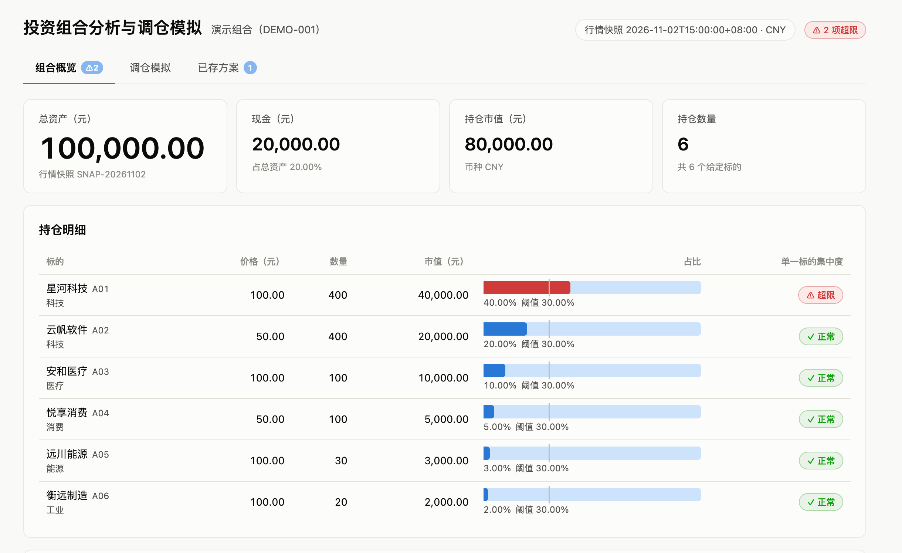
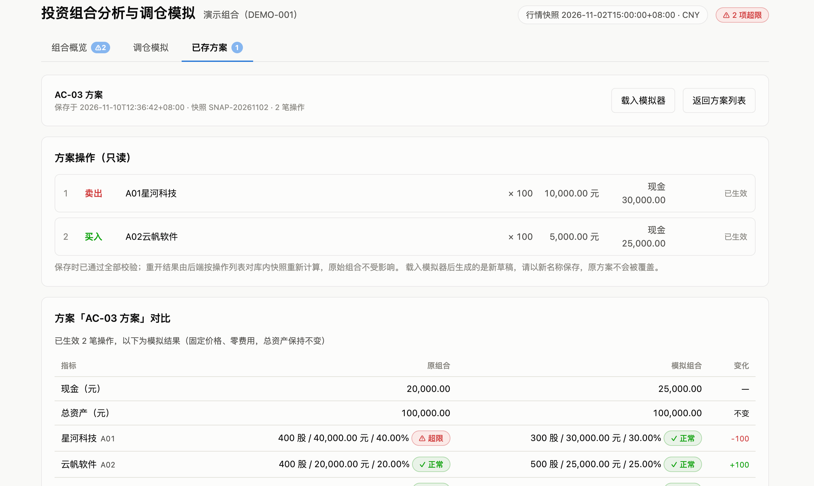
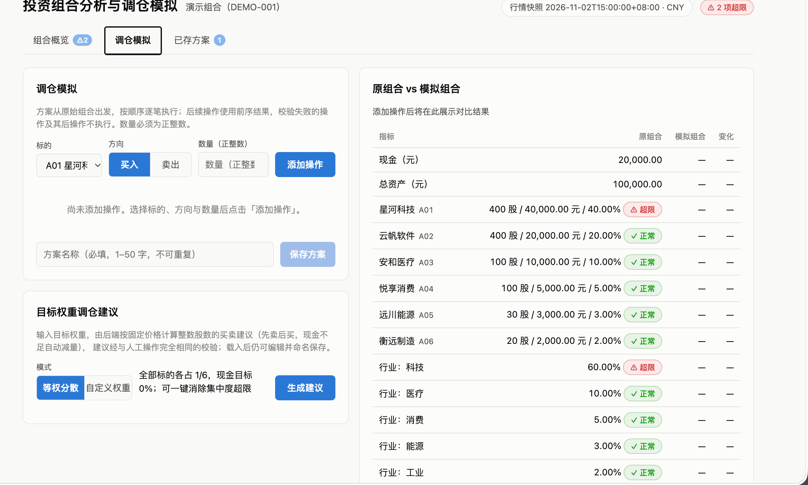
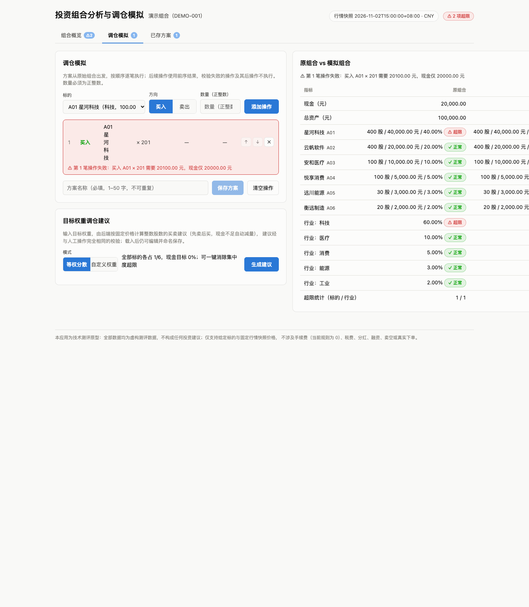
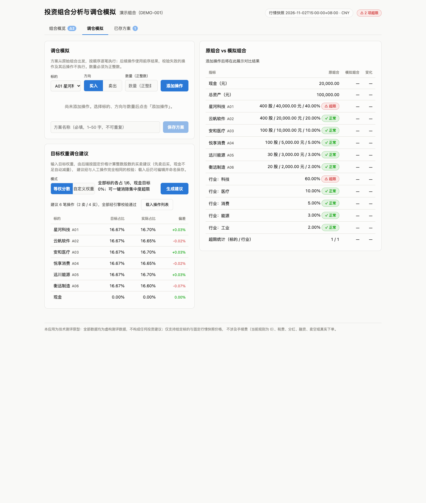

# 投资组合分析与调仓模拟

度小满全栈开发实习技术测评项目（VC-FIN-001）。基于固定行情快照的单用户组合分析原型：**组合概览 → 集中度超限识别 → 顺序调仓模拟（原组合 vs 模拟组合对比）→ 方案命名保存 → 刷新/重启后重开**。

## 功能特性

| 功能 | 说明 | 对应需求 |
|---|---|---|
| 组合概览 | 总资产 / 现金 / 持仓市值 / 持仓数量 / 持仓明细（含占比条与阈值刻度）/ 资产结构环形图 + 行业分布 / 快照时间 / 头部超限徽标 | FR-01 |
| 集中度检查 | 单一标的 >30%、行业 >50% 触发提醒（**等于不触发**，比较用展示舍入前的精确值），逐条说明触发对象、实际比例与适用阈值 | FR-02 |
| 调仓模拟 | 按顺序添加多笔买卖，逐笔执行、遇错即停；原组合 vs 模拟组合的现金/持仓/行业/超限统计对比 | FR-03 |
| 方案持久化 | 命名保存、列表、重开（只读）；刷新页面、重启服务后结果不变；原始组合始终不受影响 | FR-04 |
| 后端计算与校验 | 全部金额/占比/约束校验由后端纯函数引擎执行，操作级错误中文内联反馈 | FR-05 |
| **目标权重调仓建议**（扩展） | 等权分散 / 自定义权重；整数股数、先卖后买、现金不足自动减量；建议经与人工操作**相同的引擎校验**，附目标/实际偏差报告；一键载入后人工复核保存 | — |
| **方案删除与派生**（扩展） | 删除（二次确认）；方案载入模拟器派生新草稿，原方案只读快照不被覆盖 | — |

## 界面截图（实机运行）

以下 3 张为候选人实机运行截图，覆盖核心流程的三个页面：

| 组合概览（FR-01 / FR-02，AC-01） | 调仓模拟（FR-03，AC-03） |
|---|---|
|  |  |
| 统计卡（总资产 100,000.00、现金 20,000.00）、持仓明细（占比条带 30% 阈值刻度）、资产结构环形图 + 行业分布、集中度检查：A01 占比 40% > 30%、科技 60% > 50% 均触发提醒 | 顺序执行两笔操作：卖 A01 × 100（现金 30,000.00）→ 买 A02 × 100（现金 25,000.00）；右侧原组合 vs 模拟组合对比：科技行业 60% → 55% 仍超限、总资产 100,000.00 不变 |

| 已存方案重开（FR-04，AC-05） | 补充：错误反馈与调仓建议（自动化截图） |
|---|---|
|  |  |
| 保存「AC-03 方案」后重开：操作列表只读、模拟结果与保存时一致；列表页支持打开、删除与「载入模拟器」派生新草稿 | 左：无效操作（买 A01 × 201 现金不足）被后端拒绝，行内中文错误、已生效操作不受影响；右：目标权重调仓建议（等权分散 6 笔操作 + 偏差报告，集中度超限全部解除） |



## 设计摘要（需求理解 · 关键取舍 · AI 协作 · 复盘）

以下为摘要版，全文见 `PLAN.md`（开工方案，实现前首次提交保留原版）与 `DESIGN.md`（设计与交付说明）。

### 需求理解

基于固定行情快照的单用户组合分析原型，核心流程：**组合查看 → 集中度超限识别 → 顺序调仓模拟（前后对比）→ 方案命名保存 → 刷新/重启后重开**。关键规则：单一标的占比 >30%、行业占比 >50% 触发提醒（等于阈值不触发，比较使用展示舍入前的精确值）；现金计入总资产分母、不归入任何行业；交易数量为正整数；现金不得为负、卖出不超过当前模拟持仓；模拟从原始组合出发逐笔执行、校验失败不改变有效模拟结果；零费用下模拟前后总资产不变；原始组合与方案相互隔离。验收口径为任务书 AC-01~AC-05，全部通过（执行记录见 `VERIFY.md`）。

### 关键取舍（7 项决策，节选 5 项）

| 决策 | 选择 | 备选方案及放弃原因 |
|---|---|---|
| 存储策略 | **操作列表为唯一事实来源，读取时重算结果，不持久化计算结果** | 缓存结果 JSON：存在 ops 与结果漂移风险，重算仅为 O(n) 整数运算，缓存无收益 |
| 快照关联 | **种子快照 payload 整体入库，方案只存 snapshot_id** | 方案引用种子文件：文件被替换会改变历史方案结果，入库使历史方案自洽 |
| 模拟错误语义 | **操作级失败返回 200 + 内嵌 error（保留有效前缀状态）** | 422 整体拒绝：会丢弃有效前缀状态，违背"校验失败不得改变有效模拟结果" |
| 金额精度 | **整数「分」运算 + Fraction 精确占比比较，展示层 ROUND_HALF_UP 两位小数** | Decimal：需额外论证精度上下文与舍入模式；float：二进制浮点误差，直接排除 |
| 调仓建议校验 | **建议生成后复用与人工操作完全相同的顺序模拟引擎校验** | 独立实现校验逻辑：必然口径漂移、双重维护 |

其余两项（前端不引入路由库、SQLite 而非 JSON 文件存储）及完整论证见 `DESIGN.md` §5。

### AI 协作记录（节选 3 个片段，全文见 DESIGN.md §7）

工具：Claude Code（需求拆解、架构设计、代码与测试生成、文档草拟；人工负责确认与验证）。

1. **验收数值先验算**：开工前要求 AI 独立复算 AC 数值（总资产 100,000；卖 A01×100 后 30%/50% 恰好不触发；再买 A02×100 后科技 55% 触发），人工笔算复核一致后才作为全部测试期望值来源。
2. **测试暴露 AI 输出错误（实际核验案例）**：AI 编写的「中途失败」测试假设"卖 A01×100 后买 A01×201 会现金不足"，pytest 执行失败揭示该序列实际应成功（卖出后现金 30,000 ≥ 20,100）——人工复算确认是**测试期望值错误、引擎行为正确**，修正测试后通过。结论：AI 生成的代码与测试都必须运行验证并独立复算。
3. **配色规范校验**：行业分布调色板运行 `validate_palette.js` 校验，浅色模式 aqua/yellow 对比度 <3:1（WARN）→ 按规范采取缓解：每条直标名称与百分比、附表格视图，颜色不单独表意。

### 完成后的复盘（全文见 DESIGN.md §6）

- **已完成**：FR-01~FR-05 全部功能 + AC-01~AC-05 全部通过；扩展功能三项（目标权重调仓建议、方案删除、方案派生草稿）；后端 pytest 67 用例 + 前端 vitest 10 用例全绿；8 张截图（含 3 张实机复验）。
- **未完成项**：多用户与并发写控制（明确超出单用户范围）；深色模式截图（页面已实现深色配色）。
- **已知问题**：`fastapi.testclient` 的 httpx deprecation 警告（框架提示，不影响运行）；npm 镜像偶发 504（重试即可）。
- **与初始方案差异**：① 引擎新增逐笔「成交金额与执行后现金」（`AppliedOp`），前端零计算展示；② 完成核心流程后追加三项扩展，均以手算期望值 + 测试验证。
- **实际投入**：AI 辅助开发与自动化验证约 1.3 小时（时间线见 DESIGN.md §7），人工复核与试运行时间另计。

## 文档导航（评审阅读路径）

| 评审关注点 | 位置 |
|---|---|
| 需求拆解：FR 映射、业务规则与假设、实现范围取舍 | `PLAN.md` + `DESIGN.md` §1（FR→实现→验证映射、功能边界、状态交互） |
| 数据与状态设计：实体关系、原始组合隔离、保存内容与重算策略 | `DESIGN.md` §2 |
| 系统结构与接口设计：结构图、接口表、错误语义、前后端口径统一 | `DESIGN.md` §3 |
| 计算与异常：金额精度方案、阈值边界、验证方法、异常设计 | `DESIGN.md` §4 |
| 设计决策与取舍（7 项，含备选方案） | `DESIGN.md` §5 |
| AI 协作记录与核验（3 个真实片段） | `DESIGN.md` §7 |
| 完成情况、未完成项、与初始方案差异、复盘 | `DESIGN.md` §6 |
| 验收用例执行记录与截图 | `VERIFY.md` §2 |

## 技术栈与环境

| 组件 | 版本（实测） | 说明 |
|---|---|---|
| 后端 | Python 3.13.5 + FastAPI + sqlite3（标准库） | 依赖锁定见 `backend/requirements.txt` |
| 前端 | React 18 + Vite 5 + TypeScript（已构建，`frontend/dist/` 随包提供） | Node ≥18 仅重建/测试时需要 |
| 存储 | SQLite 文件（`backend/portfolio.db`，首次启动自动创建并写入种子快照） | 无外部服务依赖 |

支持 macOS / Linux / Windows（Python 3.10+）。

## 快速开始（推荐：无需 Node）

```bash
cd backend
python3 -m venv .venv
.venv/bin/pip install -r requirements.txt
.venv/bin/uvicorn app.main:app --host 127.0.0.1 --port 8000
```

浏览器访问 **http://127.0.0.1:8000**（前端已构建并随包提供，由后端直接托管）。

## API 一览

| 方法 | 路径 | 说明 | 成功 | 失败 |
|---|---|---|---|---|
| GET | `/api/portfolio` | 组合概览 + 集中度检查 + 规则 | 200 | — |
| POST | `/api/simulate` | 顺序模拟预览（不落库） | 200（操作级失败 200 + 内嵌 `error`，保留有效前缀状态） | 结构错误 422 |
| POST | `/api/plans` | 保存方案 | 201 | 无效操作/非法名/空方案 422；重名 409 |
| GET | `/api/plans` / `/api/plans/{id}` | 方案列表 / 重开（按操作列表重算） | 200 | 404 |
| DELETE | `/api/plans/{id}` | 删除方案 | 204 | 404 |
| POST | `/api/rebalance` | 目标权重调仓建议（equal / targets） | 200（建议 + 模拟结果 + 偏差报告） | 目标非法 422 |

错误体统一 `{"detail": {"code", "message"}}`（中文）。数值均为后端预格式化字符串，前端零计算。

## 验收结果摘要

| 用例 | 场景 | 结果 |
|---|---|---|
| AC-01 | 初始组合：总资产 100,000.00，A01 40%、科技 60% 均触发 | ✅ |
| AC-02 | 卖 A01×100：30%/50% 恰好等于阈值，两项提醒解除 | ✅ |
| AC-03 | 再买 A02×100：科技 55% 重新触发，总资产不变 | ✅ |
| AC-04 | 买 A01×201 / 卖 A01×401 / 零负小数数量：后端拒绝且不改变有效结果 | ✅ |
| AC-05 | 保存方案 → 重启服务 → 重开：结果不变，原始组合不受影响 | ✅ |

完整执行记录（步骤/预期/实际/是否通过）见 `VERIFY.md`。

## 运行测试

```bash
# 后端：引擎单元测试 + AC-01~05 API 验收测试 + 调仓建议/方案管理测试（67 用例）
cd backend && .venv/bin/pytest -q

# 前端：URL 参数解析单元测试（10 用例）
cd frontend && npm install && npm run test
```

## 方案重开步骤（FR-04 / AC-05）

1. 「调仓模拟」页添加多笔操作（如：卖出 A01 × 100，再买入 A02 × 100），输入方案名称，点击「保存方案」；
2. 切换到「已存方案」页，点击方案的「打开」查看完整对比结果（只读）；
3. 刷新页面、或 Ctrl+C 重启后端后再次打开：模拟结果不变（保存于 SQLite），原始组合始终为现金 20,000.00 元、A01 400 股、A02 400 股。

## 验收辅助 URL 参数

| 示例 | 作用 |
|---|---|
| `/?tab=overview` / `simulate` / `plans` | 指定初始页签 |
| `/?ops=SELL:A01:100,BUY:A02:100` | 预填操作列表并进入模拟页（对应 AC-03） |
| `/?ops=BUY:A01:201` | 复现 AC-04 现金不足错误反馈 |
| `/?plan=1` | 打开已保存的方案 1（对应 AC-05） |
| `/?tab=simulate&rebalance=equal` | 自动生成等权分散调仓建议 |

## 重新构建前端（可选）

```bash
cd frontend
npm install          # 若 npm 镜像超时(504)，重试一次即可
npm run build        # 产物输出到 frontend/dist/，后端自动托管新版本
```

## 开发模式（前后端热更新）

```bash
# 终端 1：后端
cd backend && .venv/bin/uvicorn app.main:app --port 8000
# 终端 2：前端（/api 自动代理到 8000）
cd frontend && npm install && npm run dev   # 访问 http://localhost:5173
```

## 目录结构

```
PLAN.md / DESIGN.md / README.md / VERIFY.md   设计文档与验证记录
data/投资组合示例数据.json                      种子数据（行情快照）
backend/app/                                    FastAPI 应用（engine 纯函数引擎 / money 精度 / db / routers）
backend/tests/                                  pytest 测试（AC-01~05 映射）
frontend/src/                                   React 源码（组件化，深浅双模式）+ vitest 测试
scripts/screenshots.sh                          验收截图生成脚本
docs/screenshots/                               验收截图
```

## 常见问题

- **端口 8000 被占用**：改用 `--port 8001` 启动；若前端需重建则同步修改 `vite.config.ts` 代理。
- **npm install 超时（504）**：npm 镜像偶发超时，直接重试一次即可（已实测）。
- **Python 版本**：3.10+ 均可；依赖全部锁定在 `backend/requirements.txt`（含传递依赖）。
- **数据库重建**：删除 `backend/portfolio.db` 后重启服务即自动重建（种子快照重新入库），已保存方案随之清空。

## 提交说明

- **实际投入时长**：AI 辅助开发与自动化验证约 1.3 小时（时间线见 DESIGN.md §7，git 提交时间戳可追溯）；人工复核、文档审阅与试运行时间另计。
- **AI 工具**：Claude Code（需求拆解、方案设计、代码与测试生成、文档草拟；人工确认与验证）
- **未完成项 / 已知问题**：见 DESIGN.md §6（多用户与并发控制未做——明确超出单用户范围；无影响运行的未完成项）
- 数据均为虚构测评数据，不构成投资建议。
